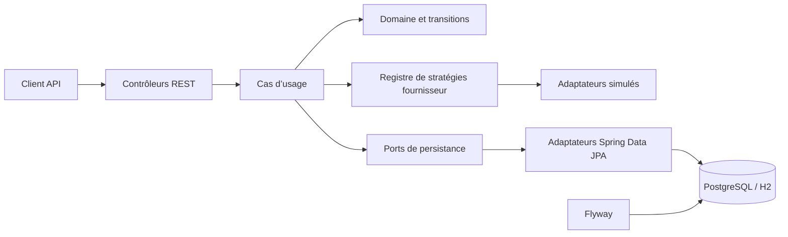

# SoaPay

> **Prototype expérimental — simulation uniquement.** Cette application n’initie aucun paiement, ne contacte aucun opérateur Mobile Money réel et ne doit pas être utilisée avec des numéros, comptes ou données financières réels.

[](https://openjdk.org/)
[](https://spring.io/projects/spring-boot)
[](https://www.postgresql.org/)
[](#statut-et-limites)

Une API REST de démonstration qui fournit un contrat unifié pour simuler des paiements, consulter leur état et simuler des remboursements. Elle met l’accent sur les frontières d’architecture, l’idempotence, les transitions d’état et la persistance PostgreSQL.

## Sommaire

- [Fonctionnalités](#fonctionnalités)
- [Architecture](#architecture)
- [Stack technique](#stack-technique)
- [Démarrage rapide](#démarrage-rapide)
- [Profils de configuration](#profils-de-configuration)
- [Authentification](#authentification)
- [API disponible](#api-disponible)
- [Exemple de requête](#exemple-de-requête)
- [Tests et qualité](#tests-et-qualité)
- [Structure du dépôt](#structure-du-dépôt)
- [Sécurité et données](#sécurité-et-données)
- [Limites et feuille de route](#limites-et-feuille-de-route)
- [Contribution](#contribution)
- [Licence](#licence)

## Fonctionnalités

- Contrats REST versionnés sous `/api/v1`.
- Fournisseurs simulés : `MVOLA_MOCK`, `ORANGE_MONEY_MOCK`, `AIRTEL_MONEY_MOCK`.
- Simulation configurable : `SUCCESS`, `FAILED`, `PENDING` ou `TIMEOUT`.
- Création de paiement protégée par `Idempotency-Key`.
- Transactions isolées par utilisateur authentifié.
- Consultation, liste des 100 transactions récentes, annulation et confirmation administrateur.
- Remboursements simulés complets ou partiels avec idempotence et verrouillage transactionnel.
- Persistance relationnelle avec PostgreSQL et migrations Flyway.
- Profil local/test avec H2 en mémoire.
- Documentation interactive OpenAPI/Swagger UI.

> Les réponses exposent `simulated: true`. Les fournisseurs présents sont des mocks ; aucun adaptateur réel n’est fourni.

## Architecture

Le projet sépare le domaine métier, les cas d’usage, les adaptateurs techniques et l’API HTTP. Les ports de persistance et de fournisseur permettent aux cas d’usage de dépendre d’abstractions plutôt que de Spring Data ou d’un opérateur particulier.



Principes appliqués :

- **SRP** : contrôleurs HTTP, cas d’usage, règles du domaine et adaptateurs ont des responsabilités distinctes.
- **OCP / DIP** : les ports isolent les cas d’usage ; les fournisseurs sont ajoutés derrière `PaymentProviderPort`.
- **Strategy + Registry** : le choix du fournisseur simulé repose sur ses adaptateurs et `PaymentProviderRegistry`.
- **Ports & Adapters** : stockage PostgreSQL/H2 et fournisseurs sont des détails remplaçables.
- **State transition** : le domaine rejette les transitions de paiement interdites.

## Stack technique

| Composant | Utilisation |
|---|---|
| Java 25 | Langage et runtime |
| Spring Boot 4.1.2 | Application, API REST, sécurité et configuration |
| Spring Data JPA / Hibernate | Persistance relationnelle |
| PostgreSQL 16 | Base de données conteneurisée pour le profil `dev` |
| H2 | Base en mémoire pour les profils `local` et `test` |
| Flyway | Migrations versionnées du schéma |
| Springdoc OpenAPI | Documentation interactive des endpoints |
| Maven Wrapper | Build et tests reproductibles |
| Docker Compose | Exécution locale de PostgreSQL et de l’API |

## Démarrage rapide

### Pré-requis

- JDK 25.
- Docker Engine et Docker Compose v2 pour la stack PostgreSQL.
- Ports disponibles : `8080` (API) et `5432` (PostgreSQL, configurable).

### Option A — exécuter l’API avec H2

Le profil `local` est actif par défaut. H2 est en mémoire : les données disparaissent à l’arrêt de l’application.

```bash
./mvnw spring-boot:run
```

L’API est alors disponible sur `http://localhost:8080`. L’authentification HTTP Basic locale utilise les comptes de démonstration décrits dans [Authentification](#authentification).

### Option B — exécuter l’API avec PostgreSQL dans Docker

1. Créer le fichier local de variables d’environnement :

   ```bash
   cp .env.example .env
   ```

2. Pour un usage partagé, remplacer les mots de passe d’exemple dans `.env`.
3. Construire et démarrer l’API et PostgreSQL :

   ```bash
   docker compose up --build -d
   ```

4. Vérifier l’état des services :

   ```bash
   docker compose ps
   docker compose logs -f api
   ```

Compose active le profil `dev`, attend que PostgreSQL soit sain avant de lancer l’API, puis Flyway applique les migrations. PostgreSQL conserve ses données dans le volume `postgres_data` et n’est publié que sur `127.0.0.1` par défaut.

Arrêt sans suppression des données :

```bash
docker compose down
```

> La suppression du volume de base de données est destructive. Ne supprimez `postgres_data` que si vous souhaitez effacer toutes les données persistées.

## Profils de configuration

La configuration commune et locale/test est dans [application.yml](src/main/resources/application.yml). Les profils PostgreSQL disposent de fichiers dédiés : [application-dev.yml](src/main/resources/application-dev.yml) et [application-prod.yml](src/main/resources/application-prod.yml).

| Profil | Base | Usage |
|---|---|---|
| `local` (défaut) | H2 mémoire | Développement sur poste ; comptes de démonstration |
| `test` | H2 mémoire | Tests automatisés ; identifiants fixes réservés aux tests |
| `dev` | PostgreSQL | Développement Docker ; paramètres fournis par variables d’environnement |
| `prod` | PostgreSQL | Configuration de production, identifiants obligatoires, fournisseurs simulés désactivés |

Le profil `prod` ne signifie pas que le logiciel est prêt pour des paiements réels : aucun connecteur opérateur ni mécanisme de traitement financier réel n’est inclus.

## Authentification

L’API utilise HTTP Basic avec deux comptes en mémoire :

| Compte local par défaut | Rôle | Autorisations principales |
|---|---|---|
| `demo-client` / `change-me-client` | `CLIENT` | Créer et consulter ses propres paiements et remboursements |
| `demo-admin` / `change-me-admin` | `ADMIN`, `TEST_OPERATOR` | Confirmer un paiement simulé en attente et accéder aux opérations CLIENT permises par les règles applicatives |

Pour Docker et les profils nécessitant des identifiants, configurer `DEMO_CLIENT_USERNAME`, `DEMO_CLIENT_PASSWORD`, `DEMO_ADMIN_USERNAME` et `DEMO_ADMIN_PASSWORD`. Ne pas conserver les valeurs d’exemple dans un environnement partagé.

## API disponible

Toutes les routes applicatives sont protégées par authentification sauf les endpoints explicitement publics comme l’état de santé et la documentation OpenAPI.

| Méthode | Route | Rôle | Description |
|---|---|---|---|
| `GET` | `/api/v1/providers` | Authentifié | Liste les fournisseurs simulés |
| `GET` | `/api/v1/providers/{providerCode}` | Authentifié | Détail d’un mock |
| `GET` | `/api/v1/providers/{providerCode}/health` | Authentifié | Disponibilité simulée |
| `POST` | `/api/v1/payments` | `CLIENT` | Crée un paiement simulé ; `Idempotency-Key` requis |
| `GET` | `/api/v1/payments` | `CLIENT` | Liste les 100 transactions récentes du client |
| `GET` | `/api/v1/payments/{reference}` | `CLIENT` | Consulte une transaction appartenant au client |
| `POST` | `/api/v1/payments/{reference}/cancel` | `CLIENT` | Annule si la transition est permise |
| `POST` | `/api/v1/payments/{reference}/confirm` | `ADMIN` / `TEST_OPERATOR` | Confirme une transaction en attente |
| `POST` | `/api/v1/payments/{reference}/refunds` | `CLIENT` | Crée un remboursement simulé ; `Idempotency-Key` requis |
| `GET` | `/api/v1/payments/{reference}/refunds` | `CLIENT` | Liste les remboursements du paiement |
| `GET` | `/api/v1/refunds/{refundReference}` | `CLIENT` | Consulte un remboursement du client |

Documentation interactive : `http://localhost:8080/swagger-ui.html`  
Spécification OpenAPI : `http://localhost:8080/v3/api-docs`  
Santé du service : `http://localhost:8080/actuator/health`

## Exemple de requête

Numéro fictif uniquement. La clé d’idempotence doit être unique par opération et réutilisée seulement pour répéter exactement la même requête.

```bash
curl --request POST 'http://localhost:8080/api/v1/payments' \
  --user 'demo-client:change-me-client' \
  --header 'Content-Type: application/json' \
  --header 'Idempotency-Key: demo-payment-001' \
  --data '{
    "provider": "MVOLA_MOCK",
    "phoneNumber": "0340000000",
    "amount": 15000.00,
    "currency": "MGA",
    "description": "Paiement expérimental"
  }'
```

La réponse fournit une référence, un état simulé et `simulated: true`. Une clé existante associée à un corps différent produit un conflit `409`.

## Tests et qualité

Exécuter la suite et construire l’artefact :

```bash
./mvnw verify
```

Les tests actuels couvrent certaines transitions de domaine et la validation du registre de fournisseurs. Les dépendances Testcontainers sont disponibles pour de futurs tests PostgreSQL. L’exécution complète de l’application par Compose est une vérification distincte de la suite Maven.

## Structure du dépôt

```text
src/
├── main/
│   ├── java/com/example/payment/
│   │   ├── application/       # DTO, ports et cas d’usage
│   │   ├── domain/            # Modèles, statuts et règles métier
│   │   ├── infrastructure/    # JPA, PostgreSQL et fournisseurs simulés
│   │   └── presentation/      # Contrôleurs et erreurs HTTP
│   └── resources/
│       ├── application.yml
│       ├── application-dev.yml
│       ├── application-prod.yml
│       └── db/migration/      # Schéma Flyway
└── test/java/                 # Tests unitaires
```

## Sécurité et données

- Utiliser exclusivement les numéros fictifs de démonstration.
- Ne pas transmettre de secrets, vrais identifiants, données personnelles ou données financières réelles.
- Le fichier `.env` est local et ne doit jamais être commité.
- Les identifiants fournis sont des valeurs de démonstration, pas des secrets sûrs.
- PostgreSQL est accessible depuis l’hôte en boucle locale par défaut ; ne pas exposer son port publiquement.
- Les mots de passe applicatifs sont encodés avec BCrypt, mais les comptes sont conservés en mémoire et ne constituent pas une gestion d’identité de production.
- HTTPS, gestion de secrets, audit métier et revue de sécurité restent nécessaires avant tout déploiement au-delà d’un environnement local expérimental.

## Statut et limites

Ce dépôt est un prototype expérimental destiné à l’apprentissage et aux essais locaux. Il ne constitue ni une passerelle de paiement, ni un service financier, ni une intégration aux opérateurs. Les mocks ne doivent pas être confondus avec des résultats ou confirmations de paiement réels.

Limites connues : authentification en mémoire, pagination non paramétrable, audit métier absent et couverture d’intégration HTTP/DB limitée. Le profil `prod` désactive les mocks, mais l’application n’est pas pour autant prête pour un usage financier ou une exposition publique.

## Contribution

Les contributions doivent conserver le périmètre de simulation, préserver l’isolation des données et ne jamais ajouter de contact opérateur réel sans une nouvelle définition explicite du périmètre du projet. Voir [CONTRIBUTING.md](CONTRIBUTING.md). Ajouter des tests pour toute règle ou route modifiée et exécuter `./mvnw verify` avant une proposition de changement.

## Licence

Consulter le fichier [LICENSE](LICENSE).
