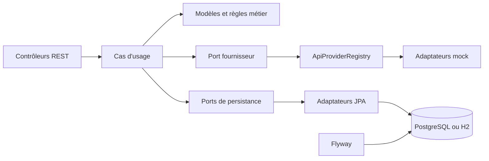
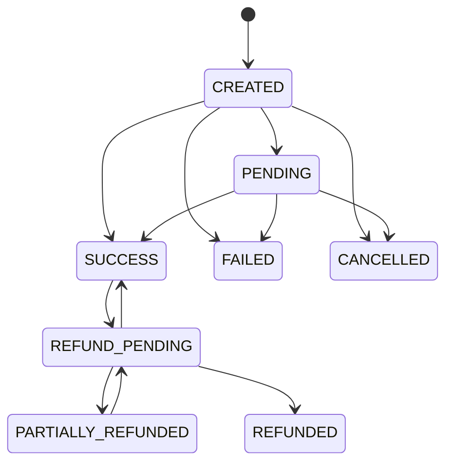

# Architecture métier

## 1. Périmètre

SoaPay est une API expérimentale qui simule des paiements Mobile Money et leurs remboursements. Elle ne contacte aucun opérateur réel et ne doit pas recevoir de données financières ou personnelles réelles. Toute réponse de paiement ou de remboursement est explicitement simulée.

## 2. Architecture générale

Le code suit une architecture en couches inspirée de Ports & Adapters. Le domaine porte les états et invariants ; les cas d’usage orchestrent les opérations ; les ports définissent les dépendances ; les adaptateurs relient ces ports aux fournisseurs simulés et à la persistance.

### Responsabilités par couche

- `presentation` : contrôleurs HTTP et conversion des erreurs en réponses API.
- `application` : DTO, ports et cas d’usage de paiement, de remboursement et de sélection de fournisseur.
- `domain` : modèles `ApiTransaction` et `ApiRefund`, énumérations et règles de transition.
- `infrastructure` : sécurité, implémentations JPA, migrations de base et fournisseurs simulés.

Le domaine ne dépend pas de Spring, de JPA ni d’un opérateur. Les cas d’usage dépendent des ports `ApiTransactionStore`, `ApiRefundStore` et `ApiProviderPort`.

## 3. Paiement simulé

1. Le client authentifié soumet un paiement et un en-tête `Idempotency-Key`.
2. L’application valide la clé, le fournisseur, le numéro fictif, le montant et la devise.
3. La clé est recherchée dans le périmètre du client. Une répétition identique renvoie la transaction existante ; une requête différente avec la même clé retourne `409 IDEMPOTENCY_KEY_REUSED`.
4. La transaction est réservée en base avant l’appel au mock. La contrainte d’unicité et la reprise après violation protègent également les créations concurrentes.
5. Le résultat mock met la transaction à jour : `SUCCESS` devient `SUCCESS`, `PENDING` devient `PENDING`, `FAILED` et `TIMEOUT` deviennent `FAILED` avec un code simulé.

Les montants doivent être strictement positifs, comporter au plus deux décimales et au plus douze chiffres entiers. Les devises doivent être des codes ISO 4217 reconnus par l’application. Les numéros sont limités au format fictif `03[234][0-9]{7}`.

### États de paiement

Les transitions non prévues par le modèle sont rejetées avec `409 INVALID_STATE_TRANSITION`. La confirmation est réservée aux rôles `ADMIN` et `TEST_OPERATOR`. Le client ne peut consulter et modifier que ses propres transactions.

## 4. Remboursement simulé

- Un remboursement est autorisé uniquement pour une transaction `SUCCESS` ou `PARTIALLY_REFUNDED`.
- Il doit être positif, respecter les limites de précision du paiement et ne pas dépasser le montant restant remboursable.
- Sa clé d’idempotence est unique par client et le contenu comparé inclut la transaction, le montant et le motif.
- Le paiement est verrouillé pendant le calcul du solde et l’écriture ; les clés différentes ne peuvent donc pas dépasser le montant d’origine par concurrence.
- Le flux est synchrone et transactionnel : l’état du remboursement passe de `PENDING` à `REFUNDED` au cours de la même requête. L’état intermédiaire n’est pas présenté comme un traitement asynchrone.
- Le paiement passe à `PARTIALLY_REFUNDED` ou à `REFUNDED` selon le total remboursé. Le remboursement hérite de la devise du paiement.

## 5. Fournisseurs simulés

`ApiProviderRegistry` associe chaque valeur de `ApiProvider` à un adaptateur `ApiProviderPort` et vérifie au démarrage qu’il existe exactement un adaptateur pour chaque fournisseur. Les fournisseurs disponibles sont `MVOLA_MOCK`, `ORANGE_MONEY_MOCK` et `AIRTEL_MONEY_MOCK`.

Le résultat de simulation est configuré par `API_SIMULATION_RESULT` en profils non-production (`SUCCESS`, `FAILED`, `PENDING` ou `TIMEOUT`). En profil `prod`, les adaptateurs restent présents mais sont marqués indisponibles : aucune intégration réelle ne les remplace.

## 6. Persistance et profils

Flyway versionne le schéma relationnel ; Hibernate valide celui-ci au démarrage. H2 en mémoire est utilisé par défaut et pour les tests. Le profil `dev` utilise PostgreSQL, notamment via Docker Compose. Le profil `prod` utilise PostgreSQL et un resource server JWT/OIDC configuré avec `OAUTH_ISSUER_URI`.

Les migrations et adaptateurs JPA protègent les contraintes persistées, notamment les clés d’idempotence, statuts et formats attendus. Les invariants entre plusieurs remboursements sont protégés par transaction et verrouillage du paiement, et non par une contrainte simple sur une ligne.

## 7. Sécurité et tests

Les profils `local`, `dev` et `test` utilisent HTTP Basic et des comptes en mémoire. En production, l’authentification utilise un JWT dont le sujet `sub` identifie le client et dont le claim `roles` fournit les rôles. La santé Actuator et la documentation OpenAPI sont publiques ; les routes métier nécessitent une authentification.

La suite comprend des tests de validation, cas d’usage, domaine, mocks, erreurs HTTP et sécurité HTTP. Un test de persistance PostgreSQL avec Testcontainers est également présent et est désactivé automatiquement si Docker n’est pas disponible. Vérification complète : `./mvnw verify`.

## 8. Limites

Le projet n’inclut ni adaptateur réel, ni règlement financier, ni traitement asynchrone, ni audit métier. La présence d’un profil nommé `prod` ne constitue pas une certification de sécurité ou une autorisation d’exploitation financière.